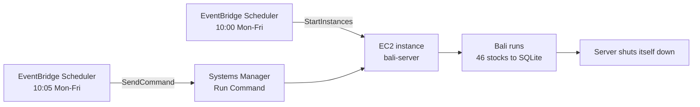

# Bali – Asian Stock Market Data Fetcher

Bali is a small Python project that collects and stores recent price data for 46 Chinese companies listed in Hong Kong, Shanghai, Shenzhen and the United States. It is the first building block (the "Data Fetcher") of a larger, planned multi-agent analysis system.

This is a learning project. I am building it step by step, with the help of AI assistants, and I make sure I understand and can explain every part of the code.

## What it does

- Downloads the last 5 trading days of prices for each ticker with `yfinance`
- Calculates the latest closing price and the 5-day percentage change
- Saves the results to a local SQLite database (one row per ticker per day; running the script again on the same day updates the rows instead of duplicating them)
- Prints a report sorted by sector
- Handles missing data and errors, and lists the tickers that failed

## Coverage

| Market | Tickers |
|---|---|
| Hong Kong (`.HK`) | 16 |
| Shanghai (`.SS`) | 9 |
| Shenzhen (`.SZ`) | 9 |
| Chinese companies listed in the US | 12 |

Sectors include tech/AI, automotive, finance, semiconductors, energy, renewable energy, e-commerce and more.

## Tech stack

Python · pandas · yfinance · SQLite

## Project structure

| File | Purpose |
|---|---|
| `asia_app.py` | Main script: downloads data, builds the report |
| `bali_memory.py` | SQLite layer: creates the database and saves reports |
| `check_db.py` | Small helper that counts the rows in the database |

## How to run

```bash
pip install pandas yfinance
python asia_app.py
```

The database file `bali_data.db` is created automatically on the first run. To check how many rows it contains:

```bash
python check_db.py
```

## Known limitations

- `yfinance` is an unofficial data source (it reads Yahoo Finance data). Data can be incomplete, delayed or change without notice, so this project is meant for learning and personal experimentation.
- Data validation is still basic.
- Bali is currently a data collection and processing script. It is not yet an AI agent.
- The output is data and analysis only, **not investment advice**.

## Roadmap

- [ ] Stronger data validation
- [ ] Charts and generated reports
- [x] Automatic daily run
- [ ] Analysis of the collected data
- [x] Cloud deployment on AWS (scheduled run, storage)
- [ ] AI-agent functions and a multi-agent team (researcher, analyst, tester, coder, coordinator)

## Author

Built by Királyhidi Nóra as part of a career change toward AI and cloud development.

## Deployment on AWS

Bali runs automatically in AWS every weekday, with no manual steps.

### Architecture



### How it works

1. **10:00 (Europe/Budapest)**: an EventBridge Scheduler schedule starts the EC2 instance.
2. **10:05**: a second schedule sends an SSM Run Command that runs Bali as a non-root user, then shuts the server down.
3. The server runs for only a few minutes per day.

### Security design

- **No inbound ports, no SSH keys**: access only through AWS Systems Manager Session Manager
- **Least privilege IAM**: the scheduler role can only start this one instance and run only the `AWS-RunShellScript` document on it
- **Trust policy** limited to `scheduler.amazonaws.com`, with an `aws:SourceAccount` condition (confused deputy protection)
- **No long-term access keys**: only IAM roles with temporary STS credentials
- **Encrypted EBS volume** (AWS KMS)
- **Fail-safe**: 20 minute timeout, and the server shuts down even if the script fails
- **Account security**: MFA enabled, monthly budget alert
- **Verified with AWS CloudTrail**: the scheduled start was performed by the scheduler role (`AssumedRole`)

### IAM permission policy (scheduler role)

```json
{
    "Version": "2012-10-17",
    "Statement": [
        {
            "Sid": "StartBaliServer",
            "Effect": "Allow",
            "Action": "ec2:StartInstances",
            "Resource": "arn:aws:ec2:eu-north-1:<ACCOUNT_ID>:instance/<INSTANCE_ID>"
        },
        {
            "Sid": "RunBaliCommand",
            "Effect": "Allow",
            "Action": "ssm:SendCommand",
            "Resource": [
                "arn:aws:ec2:eu-north-1:<ACCOUNT_ID>:instance/<INSTANCE_ID",
                "arn:aws:ssm:eu-north-1::document/AWS-RunShellScript"
                ]
            }
        ]
    }
```

### Trust policy

```json
{
    "Version": "2012-10-17",
    "Statement": [
        {
            "Effect": "Allow",
            "Principal": { "Service": "scheduler.amazonaws.com" },
            "Action": "sts:AssumeRole",
            "Condition": {
                "StringEquals": { "aws:SourceAccount": "<ACCOUNT_ID>" }
            }
        }
    ]
}
```

### Daily run command

```bash
cd /home/ssm-user/bali-asian-stock-data-fetcher && sudo -u ssm-user timeout 20m .venv/bin/python asia_app.py; shutdown -h +1
```

- `&&` runs Bali only if the directory change succeeded
- `;` makes sure the shutdown always happens, even if Bali fails
- `sudo -u ssm-user` runs Bali as a regular user instead of root (least privilege on the server too)

### AWS services used

Amazon EC2 (Amazon Linux 2023, t3.micro) · Amazon EventBridge Scheduler · AWS Systems Manager (Session Manager, Run Command) · AWS IAM · AWS KMS · AWS CloudTrail · AWS Budgets

### Next steps

- CloudWatch Logs for the full run output and failure alerts
- Infrastructure as Code (AWS CloudFormation)
